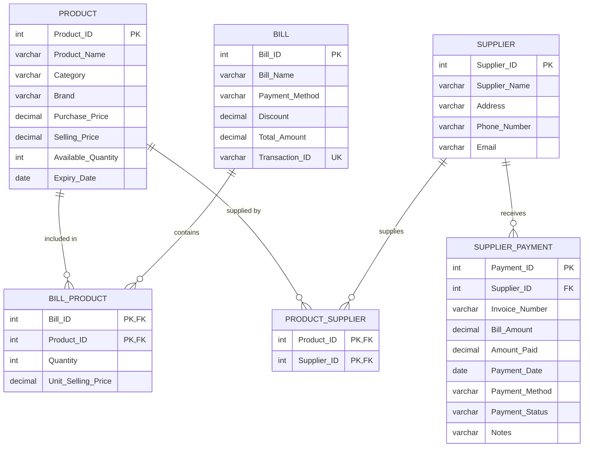

# 🛒 DailyMart - Modern Grocery Store Management & POS System

[](https://www.python.org/)
[](https://palletsprojects.com/p/flask/)
[](https://www.mysql.com/)
[](https://getbootstrap.com/)
[](https://www.chartjs.org/)
[](https://vercel.com/)

A full-stack **Grocery Store Management and Point-of-Sale (POS) Web Application** designed for shopkeepers to manage daily store operations, track sales, monitor inventory levels with interactive data visualizations, and manage supplier procurement payments with live **MySQL Database Sync**.

---

## 🌟 Key Features

### 1. 📊 Interactive Analytics Dashboard
* **Category Stock Breakdown (Doughnut Chart):** Live unit distribution across all grocery departments.
* **Revenue by Payment Mode (Bar Chart):** Compare sales earnings across UPI, Credit/Debit Cards, and Cash.
* **Top 5 High-Value Inventory Assets (Horizontal Bar Chart):** Visualizes which items hold the most store capital.
* **Real-time KPI Metrics:** Total Revenue, Total Retail Inventory Valuation, Active Products Count, and Low Stock Alerts (&lt; 40 units).

### 2. 📦 Inventory & Stock Management (Full CRUD)
* **Add Products:** Auto-calculates the next unique Product ID / barcode for quick entry.
* **Edit & Reprice:** Modify wholesale cost price, retail price, and stock levels.
* **Quick Stock Stepper:** One-click `+1` / `-1` / `+10` stock adjustment buttons that immediately commit to MySQL.
* **Profit Margin Analysis:** Real-time margin calculation (+₹) per product unit.
* **Safe Deletion:** Permanent item removal with modal confirmation.

### 3. 🧾 Customer Point of Sale (POS) & Billing
* **Interactive Invoice Cart:** Select products from a dropdown showing live stock, unit prices, and brands.
* **Dynamic Cart Rows:** Add multiple line items dynamically with quantity checks against available stock.
* **Instant Calculation:** Real-time Subtotal, Discount deductions, and Grand Total.
* **Automatic Stock Sync:** Finalizing a sale inserts records into `BILL` & `BILL_PRODUCT`, and **automatically deducts purchased quantities from the database inventory**.

### 4. 🚚 Supplier Directory & Procurement Accounts
* **Supplier Directory:** Manage wholesale distributor contacts, warehouse addresses, phone numbers, and emails.
* **Procurement Financials:** Track Total Procurement Billed (₹), Amount Paid (₹), and Outstanding Pending Balance (₹).
* **Invoice & Payment Logger:** Record wholesale supplier bills, payment modes (Bank Transfer, UPI, Cheque, Cash), and payment statuses (**Paid**, **Partial**, **Pending**).

---

## 🗄️ Database Architecture & Schema

The relational backend is structured around 6 normalized tables in **MySQL** with primary keys, foreign keys, and composite constraints:



---

## 📁 Project Directory Structure

```text
dbms-grocery-store/
│
├── api/
│   └── index.py               # Vercel serverless entry point
├── database/
│   └── GroceryShopDB.sql      # Complete SQL script (Tables, Views, Users, Seed Data)
├── static/
│   └── css/
│       └── style.css          # Custom styling & modern POS layout
├── templates/
│   ├── base.html              # Responsive Bootstrap 5 layout with navigation
│   ├── index.html             # Dashboard with Chart.js analytics & KPI cards
│   ├── products.html          # Inventory management table with search & sort
│   ├── product_form.html     # Add / Edit product form
│   ├── bills.html             # Customer orders & invoices history
│   ├── bill_create.html       # POS Customer Billing cart interface
│   ├── suppliers.html         # Suppliers directory & procurement payments
│   └── settings.html          # Database connection settings
│
├── app.py                     # Main Flask web application & API routing
├── config.py                  # Database & environment configuration
├── db.py                      # MySQL connection pool & error handling
├── requirements.txt           # Python dependencies
├── vercel.json                # Vercel routing & serverless configuration
├── .vercelignore              # Files excluded from deployment
└── README.md                  # Project documentation
```

---

## 🚀 Quickstart: Local Setup

### 1. Clone the Repository
```bash
git clone https://github.com/YOUR_USERNAME/grocery-shop-pos.git
cd grocery-shop-pos
```

### 2. Create and Activate a Virtual Environment
```bash
# Windows
python -m venv venv
venv\Scripts\activate

# macOS/Linux
python3 -m venv venv
source venv/bin/activate
```

### 3. Install Dependencies
```bash
pip install -r requirements.txt
```

### 4. Set Up MySQL Database
1. Open **MySQL Workbench** (or MySQL CLI).
2. Open and execute [`database/GroceryShopDB.sql`](database/GroceryShopDB.sql).
3. Update your MySQL credentials in `config.py`:
   ```python
   MYSQL_ADMIN_USER = 'root'
   MYSQL_ADMIN_PASSWORD = 'your_mysql_password'
   ```

### 5. Run the Application
```bash
python app.py
```
Open **[http://127.0.0.1:5000](http://127.0.0.1:5000)** in your browser.

---

## ☁️ Deployment on Vercel

This application is fully pre-configured for **Vercel Serverless Functions**.

### 1. Deploy with Vercel CLI
```bash
npx vercel
```

### 2. Configure Environment Variables in Vercel
Go to **Vercel Project Settings &rarr; Environment Variables** and add your Cloud MySQL credentials:

| Variable Name | Description | Example |
| :--- | :--- | :--- |
| `MYSQL_HOST` | Cloud MySQL Host | `gateway01.ap-southeast-1.prod.aws.tidbcloud.com` |
| `MYSQL_PORT` | Port number | `4000` (or `3306`) |
| `MYSQL_DB` | Database Name | `GroceryShopDB` (or `test`) |
| `MYSQL_ADMIN_USER` | MySQL Username | `xxxxxx.root` |
| `MYSQL_ADMIN_PASSWORD` | MySQL Password | `your_cloud_password` |

---

## 🛠️ Tech Stack

* **Backend Framework:** Python Flask
* **Database Driver:** `mysql-connector-python`
* **Relational Database:** MySQL Server / TiDB Cloud Serverless
* **Frontend:** HTML5, CSS3, Bootstrap 5, Bootstrap Icons
* **Data Visualization:** Chart.js
* **Deployment & Hosting:** Vercel (Serverless Python), Gunicorn

---

## 📄 License
This project is open-source and available under the [MIT License](LICENSE).
